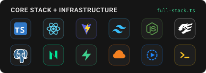

# 🥇Vitor dos Santos Pires

**Desenvolvedor Full-Stack Web** | São José, SC — Brasil  
Graduando em Sistemas de Informação na **Unisul** (5ª fase) & Técnico em Desenvolvimento de Sistemas.

<p align="left">
  <!-- <br /> -->
  <a href="https://www.linkedin.com/in/vitor-pires-74017a269/" target="_blank"></a><a href="mailto:vitorspires25@gmail.com"></a>
</p>

## Sobre

Desenvolvedor Full-Stack com foco na construção de **produtos SaaS de ponta a ponta (end-to-end)** — desde a arquitetura de interfaces e modelagem de banco de dados até automação de infraestrutura, rotinas de backup e deploy em produção.

Atuo paralelamente na área administrativa de gestão condominial (rotinas financeiras, operacionais e jurídicas). Essa vivência prática com regras de negócio reais direciona o desenvolvimento de softwares voltados para **automação operacional, gestão condominial e hospitalidade**, priorizando código limpo em TypeScript, performance e interfaces objetivas.

---

## Tech Stack & Infraestrutura

```typescript
const developerProfile = {
  frontend: [
    "React",
    "TypeScript",
    "Vite",
    "Tailwind CSS",
    "React Router",
    "Lucide Icons",
    "HTMX & Vanilla JS",
  ],
  backendAndDatabase: [
    "Node.js",
    "Fastify (REST APIs)",
    "PostgreSQL",
    "Neon (Serverless Postgres)",
    "Supabase (Auth, Database, Storage)",
  ],
  cloudAndDevOps: [
    "Cloudflare Pages (Deploy)",
    "Cloudflare R2 (Object Storage)",
    "GitHub Actions (CI/CD & Cron Backups YAML)",
    "Resend API (Transactional Emails)",
    "Registro.br (DNS & Custom Domains)",
  ],
  environment: {
    os: "Ubuntu Linux (Dual-boot) | Tilix + Zsh (Oh My Zsh & Powerlevel10k)",
    workflow: "VS Code + AI-Assisted Engineering",
    languages: [
      "Português (Nativo)",
      "Inglês (B2 - Foco em leitura técnica e comunicação)",
    ],
  },
};
```

---

## Principais Projetos

- **CondoNot:** SaaS para gestão condominial, notificações formais e relatórios (`React`, `TS`, `Tailwind`, `Supabase`, `Resend`, `Cloudflare`).
- **Site oficial Moradas do Gabriel (Landing Page, Linktree, Guia, CMS):** Web app para experiência e gestão de hóspedes em pousada (`React`, `TS`, `Tailwind`, `Supabase`, `Resend`).
- **Kanban para Administração Condomínios (KAC):** Kanban para gestão visual de rotinas administrativas em condomínios.

---
